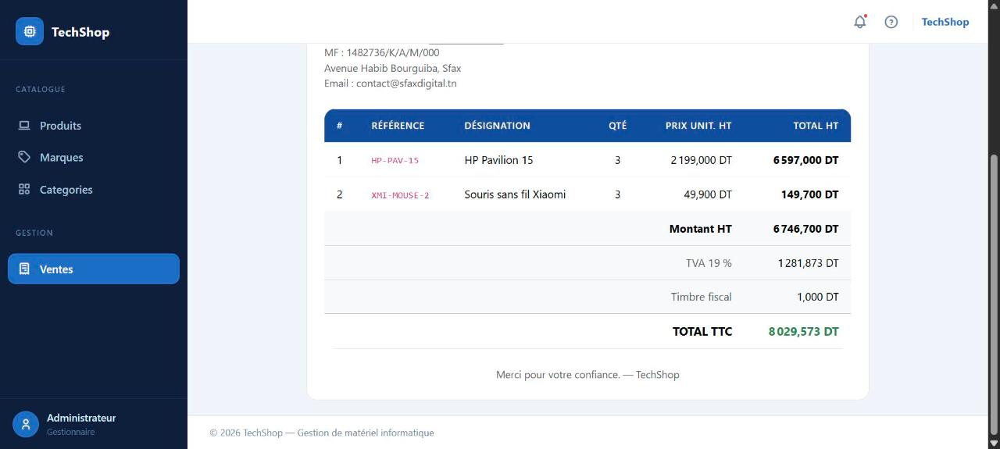
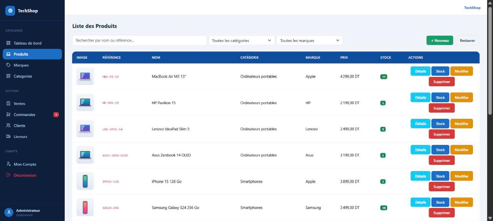
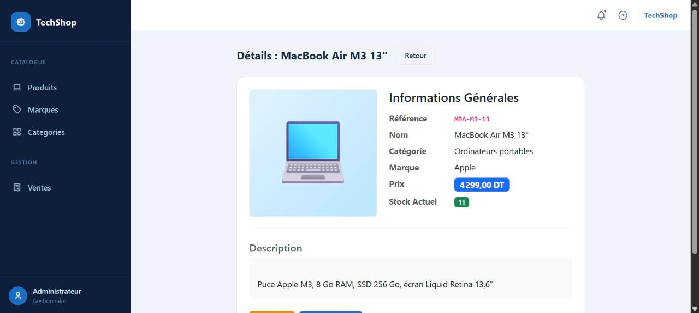
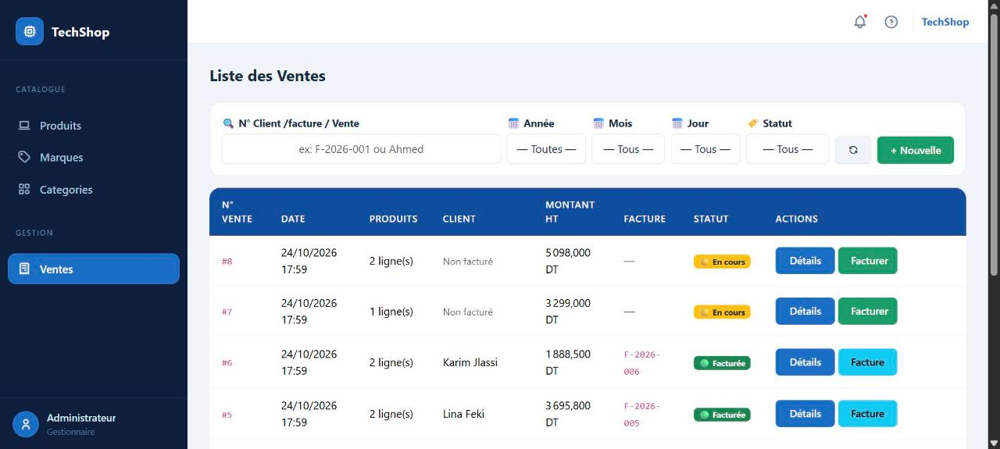
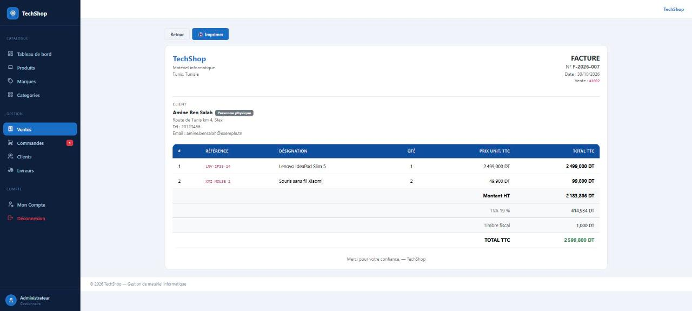

# TechShop — Gestion de boutique de matériel informatique

Application web **ASP.NET Core MVC (.NET 10)** pour un magasin de matériel informatique, en deux parties :

- une **boutique en ligne** pour les clients : catalogue, panier, commande, suivi des commandes et factures ;
- un **back-office** pour l'administrateur : produits et stock, ventes en magasin, traitement des commandes en ligne avec livreurs, clients, et facturation conforme aux règles tunisiennes (TVA 19 % et timbre fiscal).

> Projet réalisé en 2e année de Licence Génie Logiciel et Systèmes d'Information — Institut International de Technologie (IIT, Sfax).

[](https://github.com/RadhwenT/TechShop/actions/workflows/ci.yml)    

---

## Aperçu



| Catalogue des produits | Fiche produit |
| --- | --- |
|  |  |
| **Ventes et statut de facturation** | **En-tête de facture** |
|  |  |

## Fonctionnalités

### Boutique en ligne (clients)

| Module | Fonctionnalités |
| --- | --- |
| **Catalogue** | Page d'accueil publique, recherche et filtres (marque, catégorie), fiche produit avec disponibilité |
| **Panier** | Panier en session (ajout, modification des quantités, retrait), limité au stock disponible, toujours au prix actuel (le client est prévenu si un prix change avant la commande) |
| **Compte client** | Inscription, connexion, modification du profil et du mot de passe |
| **Commandes** | Commande en ligne, suivi du statut (en attente, validée, en cours de livraison, livrée, annulée), livreur affecté, consultation de ses factures |

### Back-office (administrateur)

| Module | Fonctionnalités |
| --- | --- |
| **Tableau de bord** | Chiffre d'affaires, ventes en magasin et commandes en ligne, clients, alertes de stock, meilleures ventes, graphique des ventes et répartition des commandes par statut |
| **Commandes en ligne** | Validation avec affectation d'un livreur (le stock est retiré à ce moment), expédition, livraison, annulation d'une commande en attente |
| **Clients / Livreurs** | Liste et fiche client avec historique, blocage d'un compte ; gestion des livreurs avec archive et restauration |
| **Produits** | Catalogue avec recherche et filtres (marque, catégorie), fiche détaillée, upload d'image, référence unique, suppression logique et restauration |
| **Stock** | Entrées et sorties de stock par produit, contrôle du stock insuffisant, alerte des produits presque épuisés |
| **Marques / Catégories** | CRUD complet, recherche, contrôle des doublons, corbeille avec restauration |
| **Ventes en magasin** | Création d'une vente multi-produits avec décrément automatique du stock, prix figé au moment de la vente, filtres par date (année / mois / jour), statut et facturation |
| **Facturation** | Facture d'une vente en magasin ou d'une commande en ligne (pré-remplie avec les coordonnées du client), relation 1-1, numérotation automatique `F-AAAA-NNN`, client physique ou moral (matricule fiscal obligatoire). Les prix du catalogue sont TTC : HT = TTC / 1,19 au millime, TVA = TTC − HT, plus le timbre fiscal de 1 DT |

## Architecture technique

- **ASP.NET Core MVC** : contrôleurs, vues Razor, view models
- **Deux approches d'accès aux données**, utilisées volontairement :
  - **Entity Framework Core** (code-first, migrations) pour les produits, ventes, lignes de vente et factures ;
  - **ADO.NET** (`SqlConnection`, requêtes paramétrées) via le pattern **DAO** pour les marques et catégories.
- **SQL Server** (LocalDB par défaut)
- **Authentification par cookie** avec rôles `Admin` / `Client`, mots de passe hachés (`PasswordHasher`), back-office protégé par `[Authorize(Roles = "Admin")]`, protection CSRF sur tous les formulaires
- **Panier en session** (sérialisé en JSON)
- Règles métier dans le modèle : `Produit.AjouterStock()` / `RetirerStock()` empêchent un stock négatif ; `CalculFacture` centralise le calcul HT / TVA / timbre / TTC et la numérotation
- Interface **Bootstrap** : mise en page boutique pour les clients, barre latérale pour le back-office

```
TechShop/
├── Controllers/        # boutique (Store, Cart, Account) et back-office (Home, Produit, Marque, Categorie, Vente, Commande, Client, Livreur)
├── Models/             # entités, CalculFacture, DAO (ADO.NET), Data (DbContext, DbInitializer), ViewModels
├── Migrations/         # migrations EF Core
├── Views/              # vues Razor
└── wwwroot/            # CSS, JS, bibliothèques, images de produits
TechShop.Tests/         # tests xUnit (unitaires + intégration sur SQL Server)
```

## Tests

**74 tests xUnit**, exécutés à chaque push par GitHub Actions :

- **unitaires** : règles de stock (`Produit`), calcul de facture (HT déduit du prix TTC au millime, TVA, timbre, aucun millime perdu) et format du numéro `F-AAAA-NNN` ;
- **intégration sur un vrai SQL Server** lancé dans Docker par **Testcontainers** :
  - DAO ADO.NET (recherche, doublons insensibles à la casse, suppression logique et restauration, requêtes paramétrées) ;
  - ventes en magasin (décrément du stock, prix figé, refus du stock insuffisant) et factures (montants, numérotation, matricule fiscal obligatoire pour un client moral, une seule facture par vente, vente annulée non facturable) ;
  - boutique en ligne : panier limité au stock et toujours au prix actuel, commande, validation avec livreur, étapes de livraison dans l'ordre, annulation, et cloisonnement (un client ne voit ni les commandes ni les factures d'un autre) ;
  - comptes : inscription (rôle Client imposé, mot de passe haché), connexion, client bloqué (déconnecté immédiatement même s'il était déjà connecté) ;
- **sécurité** : le back-office est réservé au rôle Admin et toute action POST exige un jeton anti-CSRF.

```bash
dotnet test     # Docker doit être démarré
```

## Lancer le projet

### Prérequis

- **SDK .NET 10**
- **VS Code** avec l'extension **C# Dev Kit** (proposée automatiquement à l'ouverture du dossier)
- Une base **SQL Server** :
  - **SQL Server LocalDB**, installé avec Visual Studio ou SQL Server Express (Windows) ;
  - ou **Docker**, quel que soit le système.

Au premier lancement, l'application **crée automatiquement la base**, ajoute quelques marques et catégories de démonstration et crée le compte administrateur.

| Rôle | Accès |
| --- | --- |
| Administrateur | `admin@admin.com` / `admin123` (compte de démonstration : à changer en dehors d'un usage local) |
| Client | créer un compte depuis la boutique (*S'inscrire*) |

### Option 1 — LocalDB (Windows)

Dans VS Code, ouvrez l'onglet *Run and Debug* et lancez **TechShop (LocalDB)**. Ou en ligne de commande :

```bash
cd TechShop
dotnet run
```

L'application s'ouvre sur la boutique, http://localhost:5000 ; le back-office est accessible après connexion avec le compte administrateur.

### Option 2 — SQL Server dans Docker

```bash
docker compose up -d
```

Lancez ensuite **TechShop (SQL Server Docker)** dans VS Code, ou :

```bash
cd TechShop
dotnet run --launch-profile docker
```

La chaîne de connexion peut aussi être fournie par la variable d'environnement `ConnectionStrings__cnx`.

## Auteur

**Radhwen Trabelsi** — étudiant en Génie Logiciel à l'IIT · [LinkedIn](https://www.linkedin.com/in/radhwen-trabelsi) · [GitHub](https://github.com/RadhwenT)
